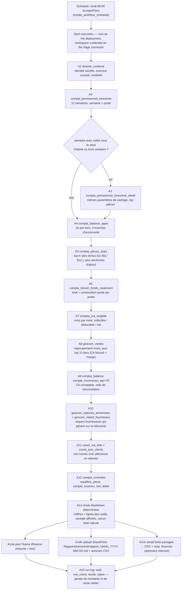
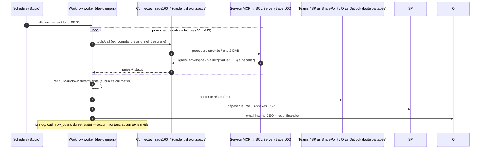

# Morgana — leveraging Mistral Workflows on a 5-seat Mistral Team

Status: draft proposal — 2026-11-14. All user-facing text in the workflows is French; tool and artifact names stay as they are.

## 1. Context

- **Morgana SAS** — Groslay (Val-d'Oise), SIREN 542 042 569, founded 1948, ~30 employees (PME), part of ENEX Technologies. Designs and manufactures finned-pack heat exchangers (evaporators, condensers, hot/cold coils) on demand from its factory north of Paris, for the food, refrigeration and HVAC segments. Three activities: **manufactures to order**, **buys components for resale**, and **provides maintenance services**.
- **Systems**: Sage 100 (gestion commerciale CIAL, comptabilité CPTA, trésorerie TRES, immobilisations IMMO) exposed to Mistral through an MCP connector (POC in this workspace: `sage100_lumiora_04fe`); Microsoft 365 (SharePoint, Outlook shared mailbox, Teams).
- **Team** (5 seats on Mistral Team): 1 accountant, 2 sales admins (quotations, orders, invoices), 1 finance manager, 1 CEO.

## 2. Ground rules inherited from the Sage connector design

1. The Sage MCP connector is **read-only for data**. The only path to a Sage write is: candidate fact → `coord_proposition_enregistrer` (SQL verifies it against Sage) → a person accepts (`coord_proposition_decider`) → `coord_proposition_deposer_demande` → `coord_demande_valider` by an authorized validator (server-side) → the integration program writes through Objets Métiers. **A workflow never writes to Sage directly.**
2. The actor of every decision is the **connected user** (on-behalf-of); the server reads it from the token, checks the validator role, the stale-token `jeton`, and makes replays idempotent. A workflow never passes a user name.
3. **Never compute a business number** (amounts, dates, delays, rankings): every figure is copied verbatim from a tool row. If a column is missing, say so.
4. A document reference always carries its **domain** (purchase vs sales): on real dossiers the same number can exist on both sides (e.g. BC2600013).
5. Customer-facing messages never contain internal `causes` (supplier names, purchase orders).

## 3. Workflow catalog

### W1 — `ma-liste-journaliere` (morning decision desk)
- **Trigger**: schedule daily 08:00 Europe/Paris; also started manually from Le Chat (`+` → Workflows).
- **Steps**: `dossier_contexte` → `coord_ma_liste` → `coord_avis_clients` → read `coord_propositions` (`statut eq 'en_attente'`) → `coord_demandes_a_valider`. Present one item at a time, in French, in the server's order. `wait_for_input` with the choices **Envoyer / Modifier / Fait autrement / Plus tard / Ne pas faire**, and **Accepter / Refuser** (refusal reason via a form) for proposals and demandes. Apply with `coord_decider`, `coord_proposition_decider` + `coord_proposition_deposer_demande`, and `coord_demande_valider(demande, decision, jeton, motif)` passing the `jeton` unchanged (re-read the list on `jeton_perime`). Show the tool's French `message` verbatim; a refusal is an answer, never retried.
- **Who**: sales admins decide supplier chases and customer notices; finance manager / accountant / CEO validate write requests (the server enforces `vous_pouvez_valider`; the author of a request cannot validate it).
- **Output**: `ChatAssistantWorkflowOutput`, published with `available_in_chat_assistant=true`. Note: an equivalent workflow already exists in the workspace (`demandes-a-valider`, deployment `lumiora-validation-essai`, hardened, on-behalf-of) — extend it rather than duplicate it.

### W2 — `relance-fournisseur` (supplier replies become checked facts)
- **Trigger**: webhook on new mail in the shared mailbox (paid tier — on the free plan triggers answer 403; fallback: hourly schedule), or a Teams/Slack message.
- **Steps**: the model may only *read* the message and extract candidate facts (quote, dates, document + domain); then `coord_interaction_enregistrer(entrant, ...)` and `coord_proposition_enregistrer(origine=message, nature, piece, domaine, tiers, citation, id_interaction)` — SQL verifies the fact (`gescom_verifier_fait_commande` rules). If `enregistre`, notify the decider (Teams) and `wait_for_input` Accepter/Refuser; on accept → `coord_proposition_decider(accepter)` + `coord_proposition_deposer_demande`.
- **Who**: sales admins.

### W3 — `avis-client-retard` (customer delay notices)
- **Trigger**: schedule daily 09:00; re-surfaces automatically on `faits_changes`.
- **Steps**: `gescom_avis_clients` / `coord_avis_clients` (server order, never re-sort, never announce an invented date — `date_a_confirmer` means warn without a date). Draft via `coord_brouillon_enregistrer` (customer-facing text only). Human picks **Envoyer** → link the message before sending (`coord_brouillon_lier_message`) → send from the shared mailbox (Graph, immutable ids, one delta link per folder) → `coord_interaction_enregistrer(sortant, envoye, ref_message)` (replayable by `ref_message`; subject only, never the body). A client reply → `gescom_verifier_reponse_client` → W2 path.
- **Who**: sales admins.

### W4 — `preparation-facture` (order → Sage-ready invoice file)
- **Trigger**: new order email in the shared mailbox, a SharePoint list item, a Teams message, or manually from Le Chat.
- **Steps**: resolve the customer's `compte tiers` and articles (`describe_entities`, `read_records`); check stock/coverage (`gescom_stock`, `gescom_lignes_client_a_risque`, `gescom_ruptures_annoncees`); build the invoice file (CSV `Date;Compte tiers;Montant eur`, the pattern of the existing order agent) or a structured draft; save to a SharePoint library and the Mistral library; `wait_for_input` confirmation by the sales admin. **Posting into Sage is not done by the workflow**: it goes through the demande circuit with finance-manager validation. The same flow covers **maintenance services** (intervention report in SharePoint → service invoice lines).
- **Who**: sales admins prepare; finance manager validates.

### W5 — `rapport-hebdo-tresorerie` (weekly finance report)
- **Trigger**: schedule Mondays 08:00 Europe/Paris; manual start from Le Chat as fallback. Unattended runs cannot be on-behalf-of → needs a workspace/org-level credential on the Sage connector. **Detailed design: [§ 4](#4-w5-rapport-hebdo-tresorerie--detailed-design).**
- **Who**: finance manager owns and reviews; CEO receives; accountant is consulted on anomalies; sales admins act on the relance list.
- **Output**: French Markdown report + CSV annexes → Teams channel + SharePoint library + email from the shared mailbox (internal recipients only). Read-only, no human gate, **no model call** (fully deterministic).

### W6 — `cloture-mensuelle` (month-end checklist)
- **Trigger**: schedule last business day 18:00.
- **Steps**: `compta_controles`; `compta_journal` (AN, ACH, VTE, OD); `compta_balance` (70, 401, 411, 445…); `compta_tva_exigible`; grand-livre spot checks (`compta_grand_livre`). Produce a checklist document in SharePoint; `wait_for_input` sign-off by the accountant; anomalies → Teams card to the finance manager.
- **Who**: accountant.

### W7 — `tableau-de-bord` (CEO dashboard, chat)
- **Trigger**: manual, from Le Chat (chat-assistant workflow).
- **Steps**: answer in French from tool rows only — `gescom_ventes` (axes: month, exercice, family, client, article), `compta_balance_par_exercice`, `compta_balance_agee`, `gescom_stock_projection`, `gescom_ruptures_annoncees`, `gescom_retard_fournisseur`, plus row counts of `coord_ma_liste` / `coord_avis_clients`.
- **Who**: CEO (and finance manager).

### W8 — `alertes-appro` (purchasing / stock alerts)
- **Trigger**: schedule daily 09:00.
- **Steps**: `gescom_ruptures_annoncees`, `gescom_stock_projection`, `gescom_lignes_client_a_risque`, `gescom_qualite_donnees_orchestration`, `gescom_relances_fournisseurs`; digest posted to the Teams purchasing channel; items needing a decision surface in W1.
- **Who**: sales admins / buyers.

## 4. W5 `rapport-hebdo-tresorerie` — detailed design

### 4.1 The problem it solves

Morgana is a 30-person industrial company with three cash-relevant activities: **manufacturing to order** (component purchases from suppliers, stock, production lead times), **buying for resale**, and **maintenance services** (invoices often paid late, with retention). Cash risk concentrates in the timing mismatch between supplier payments, customer collections, payroll/social charges and VAT. Today the finance manager either asks the accountant or exports Sage manually; exports go stale, differ from each other (e.g. Sage's aged balance imputes payments on the oldest invoices, the MCP's `compta_balance_agee` puts unallocated credits aside), and the CEO's Monday question — *"where do we stand on cash?"* — waits for someone to pull numbers.

W5 solves this with **one deterministic, weekly, French report delivered every Monday at 08:00**, where every figure is read the same morning from MCP tool rows against Sage 100, and every caveat the tool returns (`certitude`, `perimetre_exclu`, aging basis) is rendered in the report instead of being silently dropped. No human is needed in the loop (read-only), so the run is fully scheduled; a run log (tools, row counts, durations — never amounts) makes each report auditable.

### 4.2 Actors and RACI

| Actor | Role in W5 |
|---|---|
| Workflow worker (managed deployment, e.g. `morgana-rapport-hebdo`) | Runs the schedule as the deployment identity, with a **workspace/org-level credential** on the Sage connector |
| Finance manager | **Owner**: defines content and recipients, reviews the report Monday, can start the workflow manually (on-behalf-of variant) |
| CEO | Recipient (Teams + email); asks follow-ups in W7 `tableau-de-bord` |
| Accountant | Consulted when `compta_controles` anomalies or the TVA-register diagnostic appear; not in the run loop |
| Sales admins (×2) | Act on the piece-by-piece relance list surfaced in the report (through W1 `ma-liste-journaliere`) |
| Systems | Sage MCP connector (`sage100_*`) as data source; Teams channel, SharePoint library, shared mailbox as delivery |

RACI: **R** = workflow worker, **A** = finance manager, **C** = accountant, **I** = CEO, sales admins.

### 4.3 Trigger, identity and schedule

- **Schedule**: `create_workflow_schedule` on the deployment, cron `0 8 * * MON`, Europe/Paris. Before creating the schedule, run the workflow once via `execute_workflow` and check the effect in Teams/SharePoint (`read_workflow_execution_events`).
- **Identity**: a scheduled run cannot be on-behalf-of, so the connector must have a **workspace or org-scope credential** with status valid (check with `list_connector_credentials`). If only user credentials exist, the fallback is: the finance manager starts the workflow manually from Le Chat (`+` → Workflows) — that variant runs OBO on a `hardened=true` deployment and acts as the finance manager.
- **Execution timeout**: set explicitly (e.g. `execution_timeout=timedelta(hours=1)`); the SDK default is 1 h anyway, but make it deliberate.
- **No model call**: the report body is rendered by deterministic code from tool rows. (Optional: a one-paragraph intro may be model-written; the figures never are.)

### 4.4 Flow schema



### 4.5 Sequence schema



### 4.6 Activity table (tools and key parameters)

| # | Tool call | Key parameters | Feeds report section |
|---|---|---|---|
| A1 | `dossier_contexte` | — | header: société, exercice courant, modules installés; banner si `sage_mis_a_jour_depuis_deploiement = true` |
| A2 | `compta_previsionnel_tresorerie` | `date_debut` = today, horizon 12 semaines (params `semaines`, `delai_paiement`, `echu_max_jours` à garder identiques pour A3) | trésorerie: solde_ouverture / variation / solde_clôture **lus dans les colonnes**, `signal_horizon`, `creances_echues_hors_previsionnel`, `dettes_echues_hors_previsionnel`, `perimetre_exclu` |
| A3 | `compta_previsionnel_tresorerie_detail` | `semaine` = n, **mêmes** `date_debut`/`semaines`/`delai_paiement`/`echu_max_jours` que A2, `poste` optionnel, `limite` ≤ 50 (plus gros montants d'abord) | détail des semaines à expliquer (factures, tiers, montants, échéances) |
| A4 | `compta_balance_agee` | `date_arrete` = today | dû par tiers, tranches 0-30/31-60/61-90/91+, `credits_non_ventiles`, `dont_a_nouveau`, `mode_vieillissement` |
| A5 | `compta_pieces_dues` | `numero_tiers` (top K de A4 échus), `date_arrete` = today, `limite` = 50, plus anciennes d'abord | relances **pièce par pièce**, jamais sur un total |
| A6 | `compta_besoin_fonds_roulement` | `date_arrete` = today | BFR total **avec sa composition** (chaque poste dit ses comptes retenus) |
| A7 | `compta_tva_exigible` | période = exercice courant à today | TVA exigible par mois; si ligne diagnostic « registre non tenu » → banner, aucune TVA restituée |
| A8 | `gescom_ventes` | `regroupement` = `mois` puis `tiers` (limite 10), période exercice | CA **facturé** (brut, remise, net, prix de revient, marge) |
| A9 | `compta_balance` | `compte_commence_par` = `70`, `date_debut`/`date_fin` = exercice | CA comptable 70 — note: diffère normalement du CA facturé (A8) |
| A10 | `gescom_ruptures_annoncees`, `gescom_retard_fournisseur` | — | ruptures annoncées (statut_rupture d'abord), retard constaté par fournisseur |
| A11 | `coord_ma_liste`, `coord_avis_clients` | — | **row counts only** (seul nombre autorisé) |
| A12 | `compta_controles` | `famille` ∈ equilibre_piece, equilibre_journal, compte_inconnu, non_lettre | anomalies de cohérence |

Code note: the DAB-backed server wraps rows twice (`{"entity":…, "value":{"value":[...]}}`) — unwrap in code and test against **one real server answer**, not only fakes.

### 4.7 Report structure and payload contract (schema)

The report (`rapport_hebdo_YYYY-MM-DD.md`) has fixed sections: Contexte → Trésorerie 12 semaines (+ détail des semaines marquantes) → Balance âgée & pièces dues → BFR → TVA → CA (facturé + comptable) → Risques fournisseurs → Contrôles → Décisions en attente (counts) → Caveats. The machine-readable payload follows this versioned contract:

```json
{
  "$schema": "https://json-schema.org/draft/2020-12/schema",
  "title": "RapportHebdoTresorerie",
  "version": "0.1",
  "type": "object",
  "required": ["version", "generated_at", "societe", "exercice_courant", "sections", "caveats", "sources"],
  "properties": {
    "version": { "const": "0.1" },
    "generated_at": { "type": "string", "format": "date-time" },
    "societe": { "type": "string" },
    "exercice_courant": { "type": "string" },
    "sections": {
      "type": "array",
      "items": {
        "type": "object",
        "required": ["id", "titre", "source_tool", "status", "row_count", "rows"],
        "properties": {
          "id": { "enum": ["contexte", "previsionnel", "previsionnel_detail", "balance_agee", "pieces_dues", "bfr", "tva", "ca_facture", "ca_compta_70", "ruptures", "retard_fournisseurs", "controles", "decisions_en_attente"] },
          "titre": { "type": "string" },
          "source_tool": { "type": "string" },
          "status": { "enum": ["ok", "indisponible"] },
          "row_count": { "type": "integer", "minimum": 0 },
          "rows": { "type": "array", "description": "lignes telles que rendues par l'outil, sans retraitement" }
        }
      }
    },
    "caveats": { "type": "array", "items": { "type": "string" }, "description": "perimetre_exclu, certitude estimée vs comptable, base de vieillissement, registre de taxes non tenu, etc. — rendus tels quels" },
    "sources": {
      "type": "array",
      "items": {
        "type": "object",
        "required": ["tool", "called_at", "status", "row_count", "duration_ms"],
        "properties": {
          "tool": { "type": "string" },
          "called_at": { "type": "string", "format": "date-time" },
          "status": { "enum": ["ok", "retried", "error"] },
          "row_count": { "type": "integer", "minimum": 0 },
          "duration_ms": { "type": "integer", "minimum": 0 }
        }
      },
      "description": "run log — jamais de montants ni de texte métier"
    }
  }
}
```

Example (abridged, real rows from the LUMIORA POC read on 2026-11-14):

```json
{
  "version": "0.1",
  "generated_at": "2026-11-14T08:00:00+01:00",
  "societe": "MAISON LUMIORA JOAILLERIE",
  "exercice_courant": "2026",
  "sections": [
    { "id": "previsionnel", "titre": "Trésorerie — 12 semaines", "source_tool": "compta_previsionnel_tresorerie", "status": "ok", "row_count": 14,
      "rows": [ { "semaine": 0, "poste": "Aucun mouvement prevu", "solde_ouverture": 2224751.99, "solde_cloture": 2224751.99, "signal_horizon": "Le solde reste positif sur tout l'horizon", "perimetre_exclu": "TVA : hors perimetre sur ce dossier…" } ] },
    { "id": "bfr", "titre": "Besoin en fonds de roulement", "source_tool": "compta_besoin_fonds_roulement", "status": "ok", "row_count": 11,
      "rows": [ { "poste": "BESOIN EN FONDS DE ROULEMENT", "categorie": "Total", "contribution": 716486.01, "comptes_retenus": "Emplois moins ressources d'exploitation, perimetre ref_poste_bfr", "date_arrete": "2026-11-14" } ] }
  ],
  "caveats": ["TVA hors périmètre (registre de taxes non tenu) : le solde de clôture du prévisionnel est surévalué d'autant (23 000 à 146 000 €/mois sur les dossiers mesurés)"],
  "sources": [ { "tool": "compta_previsionnel_tresorerie", "called_at": "2026-11-14T08:00:03+01:00", "status": "ok", "row_count": 14, "duration_ms": 950 } ]
}
```

### 4.8 Caveats the report must render (never hide)

1. `certitude` per poste in the cash forecast: **comptable** (real écriture) vs **estimée** (3-month average, reference period named) — never mix them in one total.
2. `perimetre_exclu` on every forecast row — on dossiers where the tax register is not kept, TVA is out of scope and the closing balance is **overstated** by 23 000–146 000 €/month; the banner must appear in the report.
3. Aged balance: aging from **date de pièce**, `credits_non_ventiles` kept aside, and when `dont_a_nouveau` is significant the `mode_vieillissement` note must be shown (reports are under-aged); `retard_sur_echeance` is NULL when no due date was entered — an answer, not a zero.
4. CA facturé (`gescom_ventes`) vs CA comptable (comptes 70) normally differ — show both with the note, don't reconcile by hand.
5. `gescom_ventes` caps at 50 groups by default: the last row without a group code sums the rest — it is not a client/article.
6. Only **row counts** may be computed (e.g. decisions pending in `coord_ma_liste`); every amount, date, delay, ranking is copied from a tool row.

### 4.9 Failure handling

- Each tool call is an activity with retry (3 attempts, backoff). If a section's tool still fails, the section renders with `status: "indisponible"` — **never fabricated data** — and a failure notice is posted to Teams.
- Connector/gateway errors (`refused_by_gateway`, 401/403) mean credential or path problem: fix the credential, don't retry blindly; a refused call is an answer.
- Overlap policy on the schedule: skip if the previous run is still RUNNING (no concurrent report for the same week).
- Privacy/ops: payload encryption on, `OTEL_ENABLED=false`, no business text in workflow inputs or search attributes; secrets only in the workspace secrets manager.

### 4.10 Delivery artifacts

- Teams channel (e.g. `#finance`): short summary (solde trésorerie départ, signal horizon, BFR, top 3 échus, anomalies) + link to the SharePoint file.
- SharePoint library `Rapports/tresorerie/`: `rapport_hebdo_YYYY-MM-DD.md` + annex CSVs (`previsionnel.csv`, `balance_agee.csv`, `pieces_dues.csv`).
- Email from the shared mailbox to **internal** addresses only (CEO, finance manager) with the report attached or linked.

### 4.11 Acceptance criteria ("done when")

1. Schedule fires Mondays 08:00 Europe/Paris; the first run was executed manually and verified before the schedule was created.
2. Report present in Teams + SharePoint + email by 08:15; deterministic re-run the same day produces identical figures.
3. Spot-check: report figures equal a manual tool call made the same day (e.g. `solde_ouverture` of the forecast, BFR total, solde 411000).
4. Caveats of § 4.8 appear whenever the tools return them.
5. No computed business number anywhere except row counts.
6. Connector failure ⇒ sections "indisponible" + Teams notice; no partial invented figures.
7. Run log has no amounts and no message text.

### 4.12 Parameters to fill for Morgana

Teams channel id · SharePoint site/library ids · shared mailbox address · internal recipient list (CEO, finance manager) · name of the workspace/org credential on the Sage connector (`list_connector_credentials`) · warning threshold for the cash horizon (solde < seuil) · top K overdue tiers for `compta_pieces_dues` (default 5) · horizon (default 12 semaines) · deployment name (suggested `morgana-rapport-hebdo`).

## 5. Role × workflow matrix

| Role (1 seat each unless noted) | W1 desk | W2 supplier replies | W3 customer notices | W4 invoices | W5 weekly report | W6 closing | W7 dashboard | W8 alerts |
|---|---|---|---|---|---|---|---|---|
| Sales admin ×2 | decides | decides | decides | prepares | — | — | — | watches |
| Accountant ×1 | validates demandes | — | — | — | — | runs + signs off | — | — |
| Finance manager ×1 | validates demandes | approves proposals | approves | validates | owns report | receives anomalies | uses | watches |
| CEO ×1 | validates exceptions | — | — | — | receives report | — | uses | — |

## 6. Implementation notes (Mistral Studio)

- Python Workflows SDK (`mistralai-workflows`), one Git repo, **managed deployments** (`deploy_workflow_deployment`); set `hardened=true` for any on-behalf-of workflow.
- **Schedules**: `create_workflow_schedule` (cron, Europe/Paris). **Webhook triggers** (`create_trigger`) require a paid tier — on the current free plan they answer 403; confirm they are included in the Team plan.
- Human-in-the-loop: `wait_for_input` with `ConfirmationInput` / `FormInput`; external approval via `signal_workflow_execution` (`approve` / `resume`) and `query_workflow_execution`. Set `execution_timeout` explicitly — the SDK default (1 h) kills an approval left overnight (e.g. `timedelta(days=7)`).
- Connectors in code use the **Studio name** (`sage100_lumiora_04fe`), `run_as="auto"` + `on_behalf_of=True` for decision workflows; keep a single connector exposing a given tool set (two connectors with the same tools confuse the chat model).
- Publish chat workflows so they appear in Le Chat: entrypoint annotated `-> ChatAssistantWorkflowOutput`, then `PUT /v1/workflows/{id} {"available_in_chat_assistant": true}`.
- MCP transport detail: the DAB-backed server wraps rows twice (`{"value":{"value":[...]}}`) — unwrap in code and test against **one real server answer**, not only fakes.
- Privacy / ops: payload encryption on, `OTEL_ENABLED=false`, no business text in workflow inputs or search keys, secrets only in the workspace secrets manager (never in code, logs or chat). The EU endpoint and zero-retention cover **stateless model calls only**; Workflows history and Vibe Work sit at Mistral — get the client's written consent (data residency) before go-live, and get execution/schedule pricing in writing (not published).
- M365: SharePoint libraries for reports / CSV / checklists; shared mailbox through a dedicated Entra app (delegated Graph, immutable ids, per-folder delta links, delta links treated as sensitive state); Teams for notifications.

## 7. Phased rollout

- **P0 (week 1)**: W1 decision desk (extend the existing `demandes-a-valider` deployment) + the `ma-liste` skill shared with the team; W7 dashboard.
- **P1 (weeks 2–3)**: W2 supplier chases, W3 customer delay notices.
- **P2 (month 2)**: W4 invoice preparation (incl. maintenance interventions), W8 alerts.
- **P3 (months 2–3)**: W5 weekly treasury report, W6 month-end closing.

## 8. Prerequisites / open questions for Morgana

1. Mistral Team plan: 5 seats, confirm triggers/webhooks included, pricing in writing for executions, schedules and history retention.
2. A Sage 100 MCP connector **per company dossier** — the POC connector points at the LUMIORA dossier; Morgana needs its own deployment of the same MCP server (plus the coordination SQL module if write-requests are wanted).
3. A workspace/org-level credential on the Sage connector for unattended schedules (schedules cannot run on-behalf-of), or accept that scheduled runs are started by a person.
4. M365: SharePoint site + libraries, shared mailbox + Entra app registration with admin consent, Teams channels.
5. Validator rules in Sage for `demande_*` (finance manager + accountant; CEO for exceptions), including "the author cannot validate their own request".
6. Data-residency consent for Vibe Work / Workflows history at Mistral.
